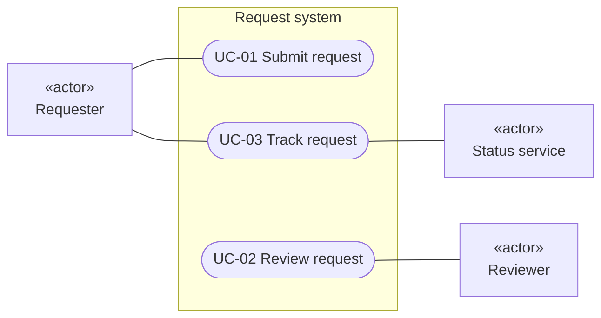
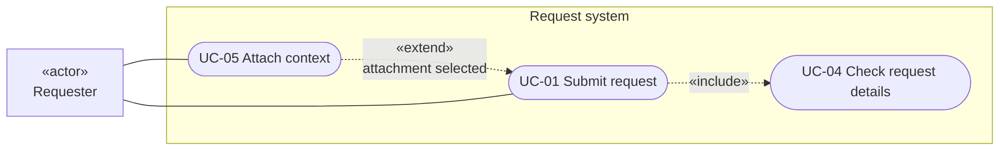
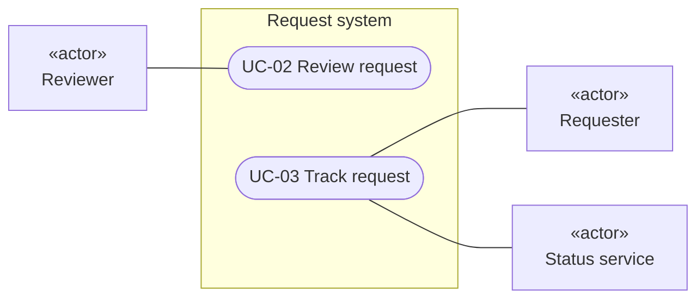

# UML Use Case Modeling Standard

## Scope and Ownership

This Standard governs analysis, notation, layout and verification when creating or updating use case models, with or without a user interface. MUST / MUST NOT are requirements; SHOULD allows a documented reason to differ.

In the kit, this file is the reusable source. In a consumer project, adopt it as `docs/04-standards/use-case-modeling.md`; reconcile an existing standard rather than creating a competing owner. Product actors, goals, data permissions and business rules belong in `docs/03-product/` (for example, `use-cases.md`, with descriptions split out only when useful). Required capability contracts belong in `docs/05-specs/`; significant decision rationale belongs in `docs/06-decisions/`. Link to those owners instead of copying their rules here. Issues/PRs retain work status and verification evidence.

## 1. Analyze Before Drawing

1. Read authoritative product decisions and relevant implementation/tests first. Distinguish **observed current behavior**, **confirmed target behavior**, **proposals** and **open decisions**. Cite sources and the inspected commit for current behavior; a target diagram is not proof of implementation.
2. Confirm the diagram's purpose (current or target), system boundary, audience, in-scope goals and exclusions before settling actors. Label separate current/target views explicitly. Do not expand scope to make the product appear complete.
3. Clarify requirements in short rounds, usually **one or two related decisions per round**, in the developer's working language. Give concrete scenarios, options, a recommendation and trade-offs. Read discoverable facts before asking; wait for answers before deciding dependent parts.
4. Resolve actor roles, goals, terminology, data ownership/permissions and exceptions. Give unresolved policies stable decision IDs, their impact and the affected use cases; do not invent defaults. Distinguish accepted decisions from proposed ones and link their evidence.
5. Summarize confirmed understanding and decisions allowed to remain open. Obtain developer confirmation before finalizing the model. A request to explain or compare does not itself authorize document changes.

Preserve the project's existing approval boundaries. Modeling does not itself authorize code changes, installation, viewer configuration changes, commits, publication, merge or deployment.

## 2. General to Detail

Present the model in this order: **system-wide General → coverage mapping → functional detail diagrams → descriptions and decision references**.

| Part | Required content |
|---|---|
| General | All logical actors and their main concrete goals. Broad labels such as “Account management” may group use cases but MUST NOT replace the main use cases inside them. |
| Coverage mapping | Each group, main use case IDs visible on General, additional supporting behavior in detail, and links to detail/descriptions. Account for the entire inventory; no silently omitted function. |
| Detail | The same IDs, names and meanings as General, with supporting behavior and UML relationships where justified. A detail diagram need not contain include/extend. |
| Descriptions | ID/name, primary/supporting actors and their participation, trigger, preconditions, main flow, observable postconditions, alternatives/errors and links to rules/open decisions. Record extension points in the base use case when using extend. |
| Evidence and open decisions | Current-versus-target differences, source/approval references, unresolved decision IDs and their effects. Keep task progress in Issues/PRs. |

A main use case expresses an actor goal with an observable outcome, not a button, endpoint or internal component. Included/extension behavior supports that goal. All views describe one model; grouping or decomposition does not create UML relationships. Actor, group and use case counts follow actual scope, with no fixed quota.

### Description Depth by Stage

During initial project modeling, describe every inventoried use case at goal level: stable ID/name, known primary/supporting actors and participation, intended observable outcome, confirmed constraints and linked open decisions. Keep General → mapping → detail views at that level; diagram detail does not require fully specified execution steps for the entire system. Preserve already confirmed flows and exceptions. Mark unknown triggers, preconditions, steps and alternatives explicitly open instead of inventing them or requiring all future-feature requirements before the initial model can be reviewed.

Before implementing a feature, refine its affected descriptions through the feature-development playbook: trigger, preconditions, main flow, postconditions, alternatives/errors and applicable rules/decisions. Resolve decisions that block that feature, and synchronize the affected views, actor inventory and relationship table. Future-feature details may remain open. The description fields above are the full contract at this stage, not an instruction to specify the entire product upfront.

## 3. UML Meaning and Permissions

- An **actor** is a role outside the boundary being modeled, played by a person or another system. An internal component or interaction channel is not automatically an actor.
- An **association** is a solid, undirected line to the specific use case the actor participates in. It conveys neither execution order nor permission to every use case in a group. Document data-access rules explicitly.
- For each use case ID, reconcile **primary actors** (whose goals it serves) and **supporting actors** (external roles/services collaborating with it) across General, detail, the use case inventory and descriptions. Record direct interaction separately from participation through an included use case (name its ID), conditional extensions and exception-only interaction (name the condition/step). Explain differences due to each view's level of detail. Do not infer a direct association transitively through include/extend, or turn any association into unrestricted access.
- Every external-service interaction in a main or alternative/error flow MUST have a corresponding supporting actor and association to the use case responsible for that interaction, or an explicit explanation and reference to the other use case that owns it. If the owner appears only in detail, make that traceable from the inventory/mapping. Do not invent a relationship just to connect descriptions: neither execution order nor asynchronous timing justifies include/extend.
- **include:** a dashed arrow from the including use case **to the included behavior**, required at the relevant inclusion point. Consecutive tasks alone do not justify include.
- **extend:** a dashed arrow from the extending use case **to the base use case**. State the condition and the base's extension point; the base remains meaningful without the extension.
- An existing authenticated session/permission is usually a precondition; do not include “Log in” in every protected action. Later callbacks, asynchronous work or follow-up tasks are not automatically include/extend.
- Use **generalization** only for actual specialization/substitutability with valid inherited relationships; it MUST NOT silently grant permissions. If needed, identify the specialized/general roles explicitly and verify hollow-triangle notation in the target viewer rather than substituting an ordinary flow arrow.
- Inventory each include/extend relation in a table: source, target, type, inclusion point or extension point/condition, and reason. Keep directions and conditions consistent with diagrams and descriptions.

Semantic reference: [OMG UML 2.5.1, chapter 18](https://www.omg.org/spec/UML/2.5.1/PDF).

## 4. Mermaid in Markdown

- The diagram source MUST be a fenced `mermaid` block directly in Markdown, displayed through a Mermaid-capable Markdown preview. Image export is not required. Separate images, HTML pages or duplicate diagram source files are not default deliverables; temporary render artifacts are verification aids.
- For compatible viewers, use `flowchart` as a **presentation convention for UML use cases**, not a process flow or a claim of native UML notation: actor boxes labeled `«actor»`, stadium/rounded use case nodes, a system `subgraph`, and optional functional subgroups. Explain the convention beside the model.
- Keep stable model IDs/names and one Mermaid node ID per actor role in each diagram. Group frames are layout labels, not new actors, use cases or service boundaries. Break long labels at readable phrases with ` ` when supported.
- Use `---` for associations and labeled dashed `-.->` arrows for `«include»` / `«extend»` in the directions above. Never add a semantic edge merely to force layout. Comment every invisible layout-only edge with its purpose and lack of model meaning.
- Check the actual Markdown viewer/version. Native syntax, renderer availability and configuration support vary; do not assume a new syntax/plugin is installed or change user settings without authority.

Syntax reference: [Mermaid flowcharts](https://mermaid.js.org/syntax/flowchart.html). A subgraph's direction can be ignored when its nodes link outside it. Source order alone does not guarantee placement. Renderer choices such as ELK depend on the viewer and version.

## 5. Layout for Reading

1. Keep use cases inside the system and actors outside. Place actor displays on either side to reduce crossings; reversing the ends of `---` for layout preserves association meaning.
2. Each actor role MUST appear **once per diagram**, especially on General, with one stable Mermaid node ID; connect its directly interacting use cases to that node. The same actor may appear again in other detail diagrams. Different Mermaid IDs create separate nodes; matching labels or a note do not make them references to one UML model element.
3. Adjust node/column spacing and line routing until edges avoid unrelated nodes/text. Color changes alone do not fix overlaps. Spacing/curve settings are starting points, not universal required values.
   After every association addition, removal or rerouting, render and visually inspect every affected diagram again for lines crossing unrelated nodes or labels, even when the diagram still parses.
4. Keep labels legible. Permit horizontal scrolling/zoom for a large General rather than shrinking everything to fit a narrow panel. Retain one complete General before detail views.
   The examples set `flowchart.useMaxWidth: false` inside each Mermaid block to retain natural size. Use a horizontally scrollable preview when needed; verify that the target viewer honors this setting and does not clip content. Do not rely on a verification harness to supply the setting absent from the Markdown source.
   Beside a large General, give instructions for opening the Markdown preview full-screen or in a wider pane and using its scroll/zoom controls; provide links to the mapped detail views. Do not replace General with those detail views or require image export.
5. If spacing is insufficient, try actor sides, declaration/link order, orientation and line routing; inspect the render after each change. Use detail diagrams for deeper views while retaining concrete main goals on General. Do not duplicate actors or remove approved goals/permissions to simplify the picture. If the viewer cannot meet the layout needs, report the limitation and agree on a suitable UML tool before changing format; preserve installation and viewer-setting approval boundaries.

One actor per diagram is the kit's presentation convention, not a claim that UML forbids every repeated presentation. An exception requires explicit approval and tooling that maintains traceable references to the same underlying model element; creating extra Mermaid IDs is not such an exception.

## 6. Small Worked Example

This fictional request system demonstrates notation and traceability only. Its roles, goals, policies and counts are **not requirements for adopting projects**. Replace the example with the confirmed product model in `docs/03-product/`; keep this Standard as the method owner.

The detailed flows below illustrate the feature-refined stage. An initial model may keep goal-level descriptions and linked open decisions as specified in [Description Depth by Stage](#description-depth-by-stage).

All diagrams below use the Mermaid flowchart presentation convention described above. General has one `requester` node connected to both submission and tracking. The same Requester role is reused once in each relevant detail diagram; this does not add roles or permissions. The fictional Status service is outside the system boundary and supports UC-03 directly; it grants neither actor access to other requests.

### General

If General is too wide, open this Markdown preview full-screen or widen its pane; scroll horizontally and use viewer zoom while keeping labels readable. Follow [Submission](#submission) or [Review and tracking](#review-and-tracking) for detail, using the mapping below to retain coverage.

### Coverage Mapping

| Group | Main goals on General | Supporting behavior in detail | Detail |
|---|---|---|---|
| Submission | UC-01 | UC-04 Check request details; UC-05 Attach context | [Submission](#submission) |
| Review and tracking | UC-02, UC-03 | None | [Review and tracking](#review-and-tracking) |

### Submission

### Review and Tracking

### Use Case and Actor Inventory

| Use case | Primary actor / initiating context | Supporting actor | Participation and view reconciliation |
|---|---|---|---|
| UC-01 Submit request | Requester | None | Direct association on General and Submission. UC-04 is required included behavior; UC-05 participates only at the conditional extension point. Neither relationship grants access to other requests. |
| UC-02 Review request | Reviewer | None | Direct association on General and Review and tracking. Permission failures are alternatives of this use case, not a new actor or use case. |
| UC-03 Track request | Requester | Status service | Both interact directly with UC-03 on General and Review and tracking. The service supplies status in the main flow; its failure is handled within UC-03. |
| UC-04 Check request details | UC-01 provides the Requester context | None | Called through UC-01's include; no direct actor interaction or actor association to UC-04. Shown only in Submission, mapped as supporting behavior. |
| UC-05 Attach context | Requester | None | Direct association in Submission, conditional on selecting an attachment at UC-01's extension point. Omitted from General as mapped supporting behavior; invalid files are handled here without another actor. |

The inventory distinguishes goal ownership and participation; it is not a permission matrix. In this example no additional actor participates only in exceptions. If one did, identify its interaction step and reflect it in the responsible diagram and description rather than treating it as an automatic include/extend.

### Relationship Inventory

| Source | Target | Type | Point / condition | Reason |
|---|---|---|---|---|
| UC-01 | UC-04 | include | Before accepting a submission; always at that point | A submission must have valid required details. |
| UC-05 | UC-01 | extend | Base extension point `add context`; requester selects an attachment while submitting | Submission succeeds without an attachment. |

### Descriptions

| ID / name | Actor / trigger | Preconditions | Main flow and postcondition | Alternatives / errors |
|---|---|---|---|---|
| UC-01 Submit request | Primary: Requester starts submission; no supporting actor | Requester may submit | Enter details; at `add context`, optionally run UC-05; include UC-04; accept and return a request reference | Invalid details: correct them before acceptance. No attachment: continue normally. |
| UC-02 Review request | Primary: Reviewer selects a submitted request; no supporting actor | Reviewer has access to this request | Read details; record review outcome; outcome is saved | Missing permission or unavailable request: do not expose details or record an outcome. |
| UC-03 Track request | Primary: Requester opens a request reference; supporting: Status service | Requester may view this request | Check access, obtain current status from Status service for this request; display it without modification | Missing permission or unavailable request: do not expose details or query the service. Service failure: show status unavailable; do not fabricate an outcome. No additional exception-only actor. |
| UC-04 Check request details | UC-01 reaches its inclusion point; Requester context via include, no direct actor or supporting actor | Details have been entered | Check required details; return validation result | Return invalid fields; UC-01 cannot accept until corrected. |
| UC-05 Attach context | Primary: Requester selects an attachment at UC-01's `add context` point; no supporting actor | Submission is being prepared | Validate attachment against the product's accepted file policy; attach it to the submission | Invalid attachment: explain error; allow replacement or continue without it. |

For a real model, link the accepted permission/file policies and evidence rather than adopting these illustrative assumptions. Record unresolved policies by decision ID and affected use cases; do not present this example as an approved or implemented product.

## 7. Required Verification

- [ ] Scope, current/target view, external actors, permissions and policy decisions are confirmed or explicitly open.
- [ ] General shows the main concrete goals; mapping covers the inventory; IDs/names agree across diagrams and descriptions.
- [ ] Description depth matches the stage: initial modeling covers every goal and known constraints with explicit open details; affected feature descriptions are refined before implementation. Confirmed detail is retained, and unrelated future-feature detail is not required upfront.
- [ ] Primary/supporting actors agree per use case across General, detail, inventory and descriptions; direct, included, conditional and exception-only participation is distinguished with IDs/conditions. Associations do not imply unrestricted permissions.
- [ ] Each external-service interaction, including error paths, has a supporting actor at the responsible use case or a traceable explanation of another owner; include/extend is not used for ordering or asynchronous timing.
- [ ] Each role has exactly one actor node per diagram, with a stable ID; no extra Mermaid IDs were created to shorten lines.
- [ ] A layout-only edit preserves the semantic actor, use case and association sets.
- [ ] Include/extend arrows, conditions and points agree with the inventory and descriptions; no relationship is used as a timeline.
- [ ] Every Mermaid block parses **and renders**. Parse success alone does not establish readable layout.
- [ ] Inspect actual rendered output at normal and narrow preview widths, including dense groups: labels/nodes do not overlap; edges do not cross unrelated nodes/text; arrows are unambiguous. Check scrolling/zoom when needed.
- [ ] After every association change, re-render and inspect the affected diagrams for edges crossing nodes/text. A large General includes full-screen/wide-preview instructions and working links to mapped detail views.
- [ ] Record viewer/renderer version, widths, inspected diagrams and any remaining limitations in the task/PR evidence. If the target viewer is unavailable, identify the substitute and leave target compatibility unverified.
- [ ] Check links and diff. A layout-only change must not alter product meaning; confirm semantic changes separately.

For document-only changes, validate the documents and diagrams; application tests do not prove a diagram is correct. Report what was observed, what remains unverified and any open policies. A method/model approval does not establish runtime, merge or deployment acceptance.
