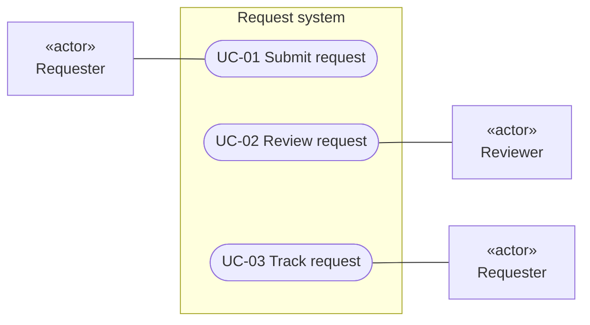
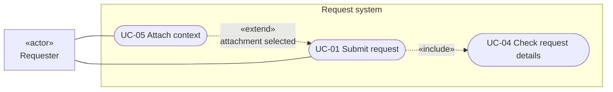
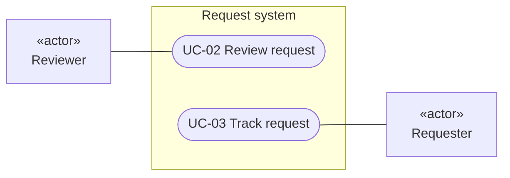

# UML Use Case Modeling Standard

## Scope and Ownership

This Standard governs analysis, notation, layout and verification when creating or updating use case models, with or without a user interface. MUST / MUST NOT are requirements; SHOULD allows a documented reason to differ.

In the kit, this file is the reusable source. In a consumer project, adopt it as `docs/04-standards/use-case-modeling.md`; reconcile an existing standard rather than creating a competing owner. Product actors, goals, data permissions and business rules belong in `docs/03-product/` (for example, `use-cases.md`, with descriptions split out only when useful). Required capability contracts belong in `docs/05-specs/`; significant decision rationale belongs in `docs/06-decisions/`. Link to those owners instead of copying their rules here. Issues/PRs retain work status and verification evidence.

## 1. Analyze Before Drawing

1. Read authoritative product decisions and relevant implementation/tests first. Distinguish **observed current behavior**, **confirmed target behavior**, **proposals** and **open decisions**. Cite sources and the inspected commit for current behavior; a target diagram is not proof of implementation.
2. Confirm the diagram's purpose (current or target), system boundary, audience, in-scope goals and exclusions before settling actors. Label separate current/target views explicitly. Do not expand scope to make the product appear complete.
3. Clarify requirements in short rounds, usually **one or two related decisions per round**, in the developer's working language. Give concrete scenarios, options, a recommendation and trade-offs. Read discoverable facts before asking; wait for answers before deciding dependent parts.
4. Resolve actor roles, goals, terminology, data ownership/permissions and exceptions. Give unresolved policies stable decision IDs, their impact and the affected use cases; do not invent defaults. Distinguish accepted decisions from proposed ones and link their evidence.
5. Summarize confirmed understanding and decisions allowed to remain open. Obtain developer confirmation before finalizing the model. A request to explain or compare does not itself authorize document changes.

Preserve the project's existing approval boundaries. Modeling does not itself authorize code changes, installation, viewer configuration changes, commits, publication, merge or deployment.

## 2. General to Detail

Present the model in this order: **system-wide General → coverage mapping → functional detail diagrams → descriptions and decision references**.

| Part | Required content |
|---|---|
| General | All logical actors and their main concrete goals. Broad labels such as “Account management” may group use cases but MUST NOT replace the main use cases inside them. |
| Coverage mapping | Each group, main use case IDs visible on General, additional supporting behavior in detail, and links to detail/descriptions. Account for the entire inventory; no silently omitted function. |
| Detail | The same IDs, names and meanings as General, with supporting behavior and UML relationships where justified. A detail diagram need not contain include/extend. |
| Descriptions | ID/name, actors, trigger, preconditions, main flow, observable postconditions, alternatives/errors and links to rules/open decisions. Record extension points in the base use case when using extend. |
| Evidence and open decisions | Current-versus-target differences, source/approval references, unresolved decision IDs and their effects. Keep task progress in Issues/PRs. |

A main use case expresses an actor goal with an observable outcome, not a button, endpoint or internal component. Included/extension behavior supports that goal. All views describe one model; grouping or decomposition does not create UML relationships. Actor, group and use case counts follow actual scope, with no fixed quota.

## 3. UML Meaning and Permissions

- An **actor** is a role outside the boundary being modeled, played by a person or another system. An internal component or interaction channel is not automatically an actor.
- An **association** is a solid, undirected line to the specific use case the actor participates in. It conveys neither execution order nor permission to every use case in a group. Document data-access rules explicitly.
- **include:** a dashed arrow from the including use case **to the included behavior**, required at the relevant inclusion point. Consecutive tasks alone do not justify include.
- **extend:** a dashed arrow from the extending use case **to the base use case**. State the condition and the base's extension point; the base remains meaningful without the extension.
- An existing authenticated session/permission is usually a precondition; do not include “Log in” in every protected action. Later callbacks, asynchronous work or follow-up tasks are not automatically include/extend.
- Use **generalization** only for actual specialization/substitutability with valid inherited relationships; it MUST NOT silently grant permissions. If needed, identify the specialized/general roles explicitly and verify hollow-triangle notation in the target viewer rather than substituting an ordinary flow arrow.
- Inventory each include/extend relation in a table: source, target, type, inclusion point or extension point/condition, and reason. Keep directions and conditions consistent with diagrams and descriptions.

Semantic reference: [OMG UML 2.5.1, chapter 18](https://www.omg.org/spec/UML/2.5.1/PDF).

## 4. Mermaid in Markdown

- The diagram source MUST be a fenced `mermaid` block directly in Markdown, displayed through a Mermaid-capable Markdown preview. Image export is not required. Separate images, HTML pages or duplicate diagram source files are not default deliverables; temporary render artifacts are verification aids.
- For compatible viewers, use `flowchart` as a **presentation convention for UML use cases**, not a process flow or a claim of native UML notation: actor boxes labeled `«actor»`, stadium/rounded use case nodes, a system `subgraph`, and optional functional subgroups. Explain the convention beside the model.
- Keep stable model IDs/names; use separate Mermaid node IDs for display copies. Group frames are layout labels, not new actors, use cases or service boundaries. Break long labels at readable phrases with ` ` when supported.
- Use `---` for associations and labeled dashed `-.->` arrows for `«include»` / `«extend»` in the directions above. Never add a semantic edge merely to force layout. Comment every invisible layout-only edge with its purpose and lack of model meaning.
- Check the actual Markdown viewer/version. Native syntax, renderer availability and configuration support vary; do not assume a new syntax/plugin is installed or change user settings without authority.

Syntax reference: [Mermaid flowcharts](https://mermaid.js.org/syntax/flowchart.html). A subgraph's direction can be ignored when its nodes link outside it. Source order alone does not guarantee placement. Renderer choices such as ELK depend on the viewer and version.

## 5. Layout for Reading

1. Keep use cases inside the system and actors outside. Place actor displays on either side to reduce crossings; reversing the ends of `---` for layout preserves association meaning.
2. Allow **multiple displays of the same logical actor** near distant groups. Keep the same role name, separate display IDs (e.g., `requester__submission`, `requester__tracking`) and a visible note explaining the duplication. Copies add no actor or permission; do not connect them as a process. Compare associations after resolving copies to their logical roles before/after a layout-only edit.
3. Adjust node/column spacing and line routing until edges avoid unrelated nodes/text. Color changes alone do not fix overlaps. Spacing/curve settings are starting points, not universal required values.
4. Keep labels legible. Permit horizontal scrolling/zoom for a large General rather than shrinking everything to fit a narrow panel. Retain one complete General before detail views.
5. If spacing is insufficient, repeat actor displays and split detailed views. Do not remove approved goals or permissions to simplify the picture; confirm any semantic change with the developer.

## 6. Small Worked Example

This fictional request system demonstrates notation and traceability only. Its roles, goals, policies and counts are **not requirements for adopting projects**. Replace the example with the confirmed product model in `docs/03-product/`; keep this Standard as the method owner.

All diagrams below use the Mermaid flowchart presentation convention described above. `requester__submission` and `requester__tracking` display the **same Requester role**, not two logical actors. Reversing the tracking association places that display on the right without changing its meaning.

### General

### Coverage Mapping

| Group | Main goals on General | Supporting behavior in detail | Detail |
|---|---|---|---|
| Submission | UC-01 | UC-04 Check request details; UC-05 Attach context | [Submission](#submission) |
| Review and tracking | UC-02, UC-03 | None | [Review and tracking](#review-and-tracking) |

### Submission

### Review and Tracking

### Relationship Inventory

| Source | Target | Type | Point / condition | Reason |
|---|---|---|---|---|
| UC-01 | UC-04 | include | Before accepting a submission; always at that point | A submission must have valid required details. |
| UC-05 | UC-01 | extend | Base extension point `add context`; requester selects an attachment while submitting | Submission succeeds without an attachment. |

### Descriptions

| ID / name | Actor / trigger | Preconditions | Main flow and postcondition | Alternatives / errors |
|---|---|---|---|---|
| UC-01 Submit request | Requester starts submission | Requester may submit | Enter details; at `add context`, optionally run UC-05; include UC-04; accept and return a request reference | Invalid details: correct them before acceptance. No attachment: continue normally. |
| UC-02 Review request | Reviewer selects a submitted request | Reviewer has access to this request | Read details; record review outcome; outcome is saved | Missing permission or unavailable request: do not expose details or record an outcome. |
| UC-03 Track request | Requester opens a request reference | Requester may view this request | Read the current outcome; state is displayed without modification | Missing permission or unavailable request: do not expose details. |
| UC-04 Check request details | UC-01 reaches its inclusion point | Details have been entered | Check required details; return validation result | Return invalid fields; UC-01 cannot accept until corrected. |
| UC-05 Attach context | Requester selects an attachment at UC-01's `add context` point | Submission is being prepared | Validate attachment against the product's accepted file policy; attach it to the submission | Invalid attachment: explain error; allow replacement or continue without it. |

For a real model, link the accepted permission/file policies and evidence rather than adopting these illustrative assumptions. Record unresolved policies by decision ID and affected use cases; do not present this example as an approved or implemented product.

## 7. Required Verification

- [ ] Scope, current/target view, external actors, permissions and policy decisions are confirmed or explicitly open.
- [ ] General shows the main concrete goals; mapping covers the inventory; IDs/names agree across diagrams and descriptions.
- [ ] Repeated actor displays resolve to the same role; a layout-only edit preserves the logical association set.
- [ ] Include/extend arrows, conditions and points agree with the inventory and descriptions; no relationship is used as a timeline.
- [ ] Every Mermaid block parses **and renders**. Parse success alone does not establish readable layout.
- [ ] Inspect actual rendered output at normal and narrow preview widths, including dense groups: labels/nodes do not overlap; edges do not cross unrelated nodes/text; arrows are unambiguous. Check scrolling/zoom when needed.
- [ ] Record viewer/renderer version, widths, inspected diagrams and any remaining limitations in the task/PR evidence. If the target viewer is unavailable, identify the substitute and leave target compatibility unverified.
- [ ] Check links and diff. A layout-only change must not alter product meaning; confirm semantic changes separately.

For document-only changes, validate the documents and diagrams; application tests do not prove a diagram is correct. Report what was observed, what remains unverified and any open policies. A method/model approval does not establish runtime, merge or deployment acceptance.
